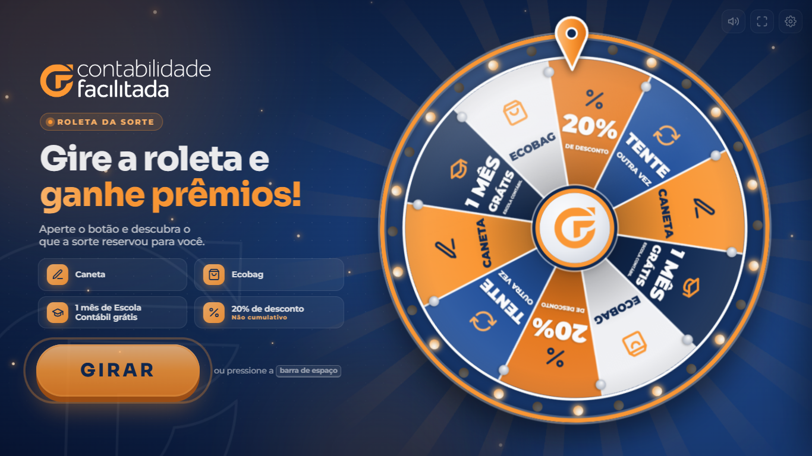
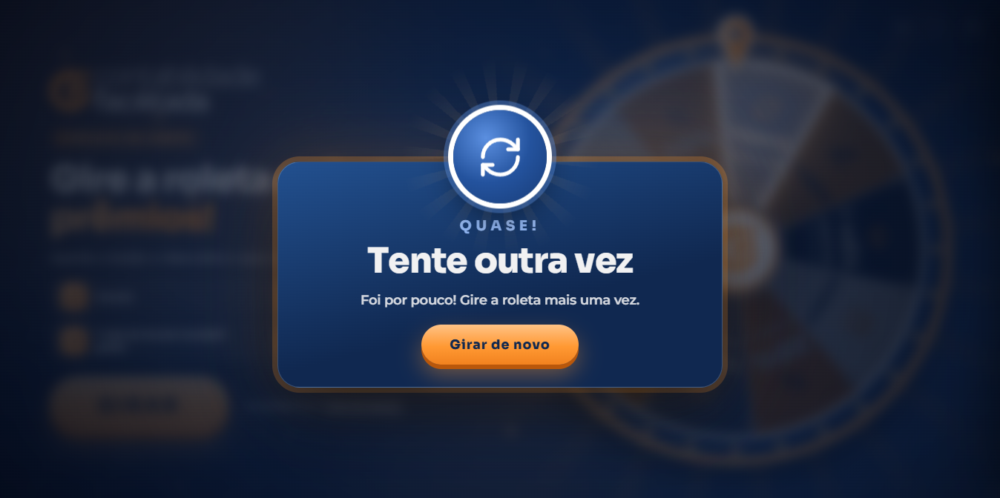
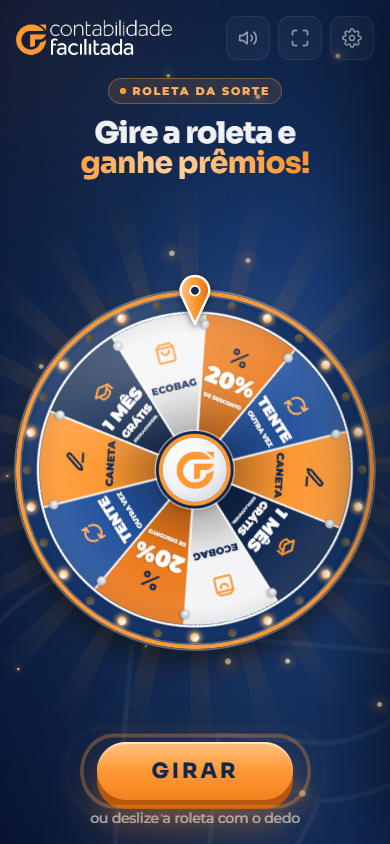
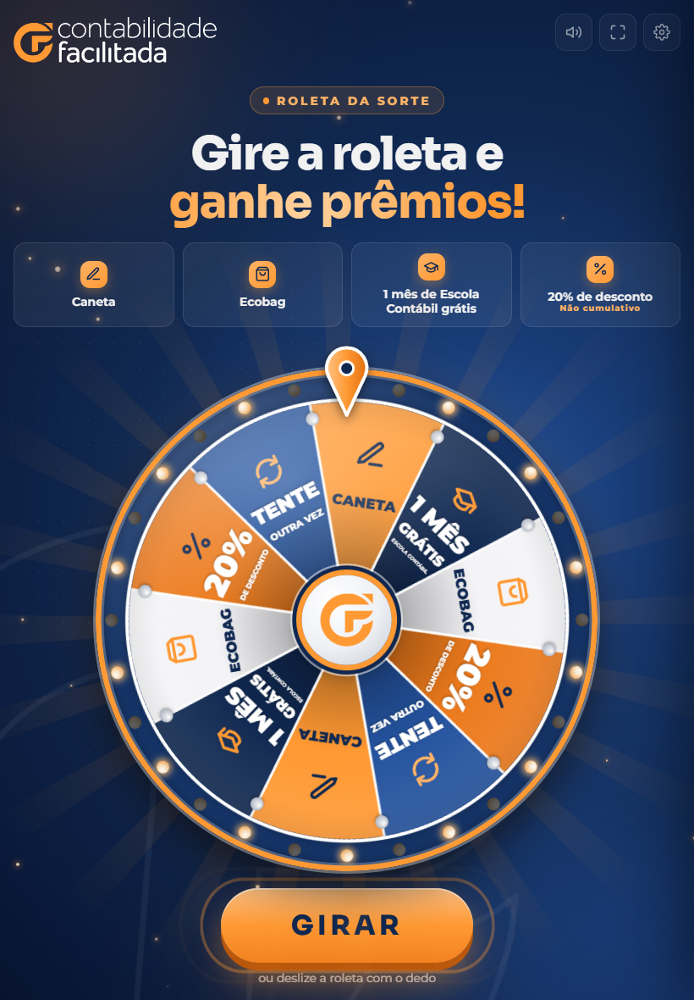
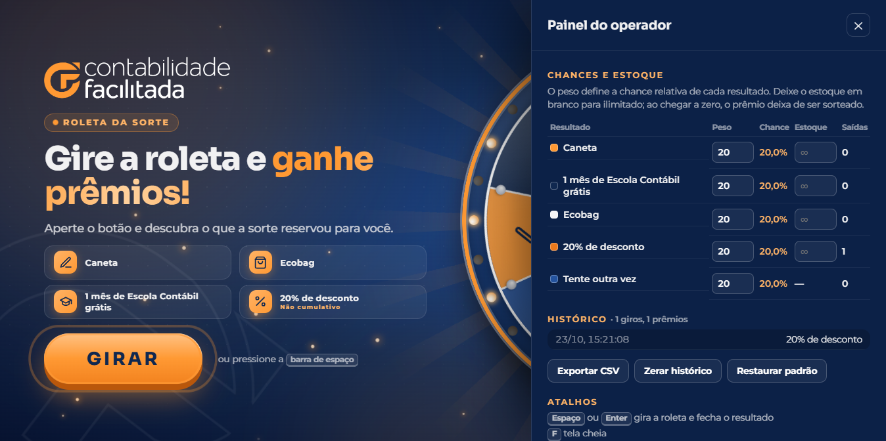

<div align="center">


# Roleta da Sorte

**Roleta de prêmios interativa do Contabilidade Facilitada para estandes e eventos presenciais.**

Abra o `index.html`, aperte a barra de espaço e deixe a sorte trabalhar.
Funciona no notebook, no tablet e no celular, sem instalação.



</div>

---

## Prêmios

| Resultado | Observação |
|---|---|
| 🖊️ **Caneta** | Brinde físico |
| 👜 **Ecobag** | Brinde físico |
| 🎓 **1 mês de Escola Contábil grátis** | Acesso à Escola Contábil |
| 🏷️ **20% de desconto** | Não cumulativo |
| 🔄 **Tente outra vez** | O participante gira de novo na hora |

Cada resultado ocupa duas fatias da roda (dez fatias no total). A chance real de cada um é definida no painel do operador, e não pelo tamanho da fatia.

## Experiência

- **Giro:** a roda recua antes de girar, desacelera aos poucos e cria suspense nos últimos pinos.
- **Deslizar com o dedo:** em telas de toque, o participante segura a roda, arrasta e solta. Ela gira no sentido do movimento.
- **Ponteiro:** balança a cada pino que passa, com um estalo sonoro.
- **Lâmpadas no aro:** piscam devagar em espera, correm em sequência durante o giro e piscam juntas quando sai um prêmio.
- **Holofote:** a fatia sorteada fica iluminada e o restante da roda escurece.
- **Prêmio:** cartão animado, confete com as cores da marca e fanfarra.
- **Tente outra vez:** a roda treme e um botão de "Girar de novo" aparece.
- **Modo de atração:** enquanto ninguém joga, a roda gira devagar para chamar a atenção de quem passa.

<div align="center">


</div>

## Checklist para o dia do evento

1. Copie a pasta inteira para o notebook (ou clone este repositório).
2. Abra o `index.html` no **Google Chrome** ou no **Microsoft Edge**.
3. Pressione `P` e configure os **pesos** e o **estoque** de cada prêmio.
4. Pressione `F` para entrar em tela cheia.
5. Faça um giro de teste. Isso também libera o som, que o navegador bloqueia até a primeira interação.
6. No painel, clique em **Zerar histórico** para descartar o giro de teste.
7. Ao final do evento, clique em **Exportar CSV** para guardar o histórico.

> **Importante:** configurações e histórico ficam salvos no navegador do notebook. Use sempre o mesmo navegador e não abra a página em janela anônima.

## Atalhos

| Tecla | Ação |
|---|---|
| `Espaço` ou `Enter` | Gira a roleta; com o resultado aberto, fecha o resultado |
| `F` | Liga e desliga a tela cheia |
| `M` | Liga e desliga o som |
| `P` | Abre e fecha o painel do operador |
| `Esc` | Fecha o resultado ou o painel |

Também é possível girar clicando no botão **GIRAR** ou no logotipo no centro da roda, ou arrastando a roda com o mouse.

## Tablet e celular

O layout se adapta sozinho ao tamanho e à orientação da tela.

| Modo | Como fica |
|---|---|
| **Celular em pé** | Logo e título no topo, roda no centro ocupando a largura, botão **GIRAR** embaixo, ao alcance do polegar |
| **Celular deitado** | Texto à esquerda e roda à direita, em versão compacta |
| **Tablet em pé** | Igual ao celular, com a lista de prêmios acima da roda nos tablets maiores |
| **Tablet deitado** | Igual ao notebook, com a lista de prêmios em uma coluna |

<div align="center">



</div>

**Recursos de toque**

- Segure a roda, arraste e solte para girar. Um toque parado não dispara o giro.
- Tocar no logotipo do centro ou no botão **GIRAR** também gira.
- No Android, o aparelho vibra a cada pino e no resultado. O botão de som também desliga a vibração.
- O painel do operador abre pelo ícone de engrenagem no canto superior direito.
- No iPhone o navegador não permite tela cheia, por isso o botão de tela cheia some. Use **Compartilhar › Adicionar à Tela de Início**: a roleta passa a abrir como um aplicativo, sem barras do navegador. No Android, use **Menu › Adicionar à tela inicial**.

**Como abrir no tablet ou no celular**

Tablets e celulares não abrem bem o `index.html` direto da memória do aparelho, por isso a roleta precisa estar em um endereço web. Escolha uma das opções:

1. **Hospedagem estática** (GitHub Pages, Netlify, Vercel ou o servidor do site): basta publicar a pasta como está. Este repositório é privado; no GitHub Pages, a publicação de repositórios privados depende do plano da organização, e o site publicado fica acessível a quem tiver o endereço.
2. **Rede local do evento:** no notebook, dentro da pasta do projeto, rode `npx serve .` (ou `python -m http.server 8080`) e abra no tablet o endereço mostrado, por exemplo `http://192.168.0.10:8080`. Notebook e tablet precisam estar na mesma rede Wi-Fi.

Depois que a página carrega, a roleta continua funcionando mesmo se a internet cair, desde que a página não seja recarregada.

> **Atenção:** pesos, estoque e histórico ficam salvos em cada aparelho. Se usar mais de um tablet, configure cada um e exporte o histórico de cada um separadamente.

## Painel do operador



| Campo | Como funciona |
|---|---|
| **Peso** | Chance relativa de cada resultado. Com todos em 20, cada um tem 20% de chance. Com Caneta em 40 e os demais em 15, a caneta passa a ter 40%. |
| **Chance** | Percentual calculado automaticamente a partir dos pesos. |
| **Estoque** | Quantidade disponível. Em branco significa ilimitado. A cada prêmio sorteado, o estoque diminui em 1. Ao chegar a zero, o prêmio deixa de ser sorteado e aparece como **Esgotado** na roda e na lista lateral. |
| **Saídas** | Quantas vezes o resultado saiu desde o último histórico zerado. |

Botões disponíveis:

- **Exportar CSV**: baixa o histórico (data, hora e resultado), pronto para abrir no Excel.
- **Zerar histórico**: apaga os giros registrados.
- **Restaurar padrão**: volta pesos e estoques ao padrão, sem apagar o histórico.

O sorteio usa o gerador criptográfico do navegador (`crypto.getRandomValues`), e o resultado é definido antes de a roda começar a girar. A animação apenas leva a roda até a fatia sorteada, sempre longe das divisórias, para evitar dúvida sobre onde ela parou.

## Personalização

Tudo o que muda com frequência fica no início de [`assets/js/app.js`](assets/js/app.js).

**Textos, cores e ícones dos prêmios:** objeto `PREMIOS`.

```js
caneta: {
  nome: 'Caneta',                         // nome no painel e na lista lateral
  linhas: [['CANETA', 1.05, 900]],        // texto na fatia: [texto, escala, peso da fonte]
  icone: 'caneta',
  cor: '#ff9933', texto: '#102850', destaque: '#102850',
  ganha: true, controlaEstoque: true,
  titulo: 'Caneta',                       // título do cartão de resultado
  subtitulo: 'Você ganhou uma caneta do Contabilidade Facilitada!',
  nota: 'Procure a nossa equipe para retirar o seu prêmio.'
}
```

**Ordem das fatias:** constante `ORDEM`, no sentido horário a partir do topo.

**Pesos e estoques iniciais:** função `estadoPadrao()`. Para valer em um notebook que já usou a roleta, clique em **Restaurar padrão** no painel.

**Cores gerais e tamanho da roda:** variáveis no início de [`assets/css/style.css`](assets/css/style.css).

## Estrutura

```
Roleta-eventos/
├── index.html              Página principal
├── manifest.webmanifest    Permite instalar na tela inicial de tablets e celulares
├── assets/
│   ├── css/style.css       Layout, animações, tema e adaptação a cada tela
│   ├── js/app.js           Sorteio, animação, gestos, sons, confete e painel
│   ├── fonts/              Sora e Montserrat (locais, para uso sem internet)
│   └── img/                Logotipos e ícones do aplicativo
└── docs/                   Capturas de tela deste README
```

## Tecnologia

- HTML, CSS e JavaScript puros, sem bibliotecas nem etapa de build.
- Roda desenhada em `<canvas>`, com nitidez ajustada à densidade de pixels da tela.
- Sons sintetizados com a Web Audio API, sem arquivos de áudio.
- Identidade visual do Contabilidade Facilitada: azul `#102850`, laranja `#FF9933`, fontes Sora e Montserrat.
- Gestos com Pointer Events (toque, caneta e mouse) e vibração com a Vibration API.
- Layout responsivo com *container queries*: no modo em pé, a roda ocupa todo o espaço livre, seja qual for a altura da tela.
- Testado em celulares de 360×740 a 430×932 (em pé e deitados), tablets de 768×1024 e 820×1180 (em pé e deitados) e notebooks de 1366×768 e 1920×1080.

---

<div align="center">
<sub>Feito pelo time do <strong>Contabilidade Facilitada</strong>.</sub>
</div>
